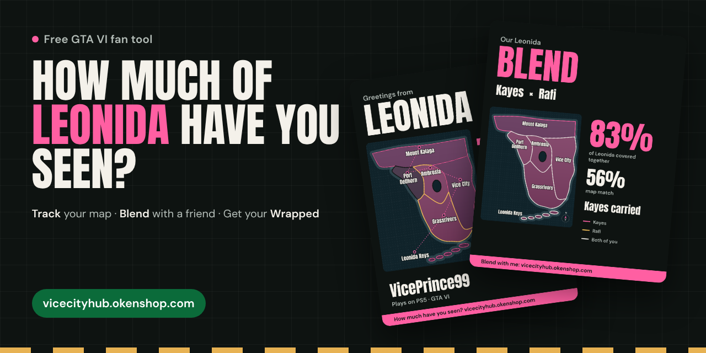
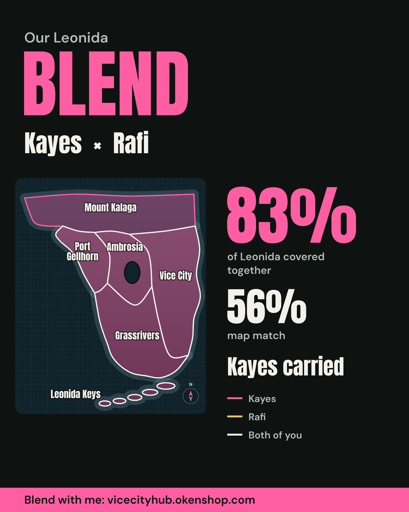
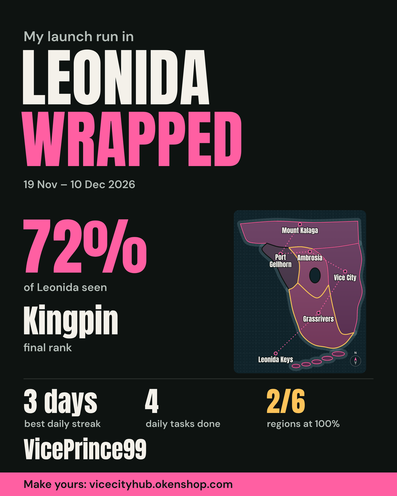
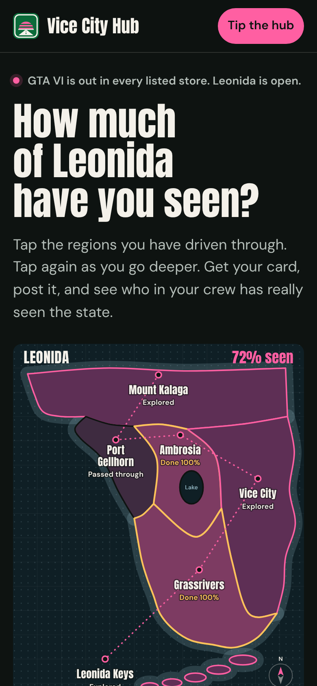
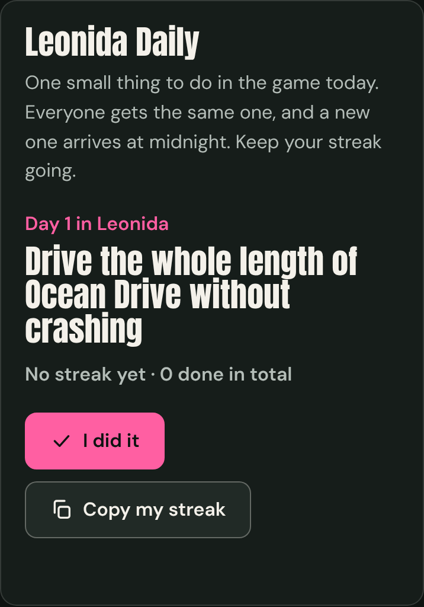

<div align="center">



# Vice City Hub

**How much of Leonida have you seen?**

A free, fast fan tool for GTA VI players. Mark the regions you have explored, get a map card worth posting,
and challenge your crew with one link.

[**Open the hub →**](https://vicecityhub0.vercel.app) &nbsp;·&nbsp; [Report a bug](https://vicecityhub0.vercel.app/report) &nbsp;·&nbsp; [Suggest an idea](https://vicecityhub0.vercel.app/idea) &nbsp;·&nbsp; [Tip the hub](https://vicecityhub0.vercel.app/#tip)


[](LICENSE)

</div>

<p align="center">
  
  &nbsp;&nbsp;
  
  &nbsp;&nbsp;
  
</p>

## What it does

| | |
|---|---|
| **All 61 cheat codes** | [Its own page](https://vicecityhub0.vercel.app/gta-6-cheat-codes): every GTA VI cheat with its button code (where known) and how to unlock it. Search, filter by type, tick off the ones you have. |
| **Map tracker** | Tap each of Leonida's six regions as you go: passed through, explored, finished. A picker under the map sets any level, and Undo takes back any change. |
| **Map card** | One tap makes a picture of your map to post, square (1:1) or story (9:16). Three looks, an optional date stamp. |
| **Leonida Blend** | Open a friend's link and make a Blend: both maps on one card, how much of Leonida you covered together, your map match, and who carried. |
| **Crew challenge** | A link that carries your score. Friends who open it see you versus them, live. |
| **Daily dare** | One small in-game dare a day, the same for everyone, with a 7-day streak row you can send to the group chat. |
| **Leonida Wrapped** | A recap card of your whole launch run: final rank, best streak, regions finished. |
| **Street name and Leonida Bingo** | A Leonida street name from your gamer tag, and a monthly 5×5 bingo card that is the same for everyone, with a playstyle label, a share image and a compare link. |

In English, Spanish and Portuguese. [Terms and privacy](https://vicecityhub0.vercel.app/legal). Everything runs in the visitor's browser. There is no sign-up, no server, no cookie banner because there are no cookies,
and no request to any other site.

<p align="center">
  
</p>

## Run it on your computer

You need nothing but Python, which most computers already have.

```sh
# fork the repository on GitHub, then clone your fork
cd ViceCityHub/site
python3 -m http.server 8000
```

Open <http://localhost:8000>. Edit a file, refresh the page. That is the whole workflow: plain HTML, CSS and
JavaScript, no framework and no build step.

## Help build it

Bug fixes and small improvements are welcome from anyone, and every pull request gets a review.

1. Pick an issue labelled [`good first issue`](https://vicecityhub0.vercel.app/good-first-issues), or open one.
2. Fork, make your change, run the checks (below).
3. Open a pull request. The checks run on it automatically.

The details, including what makes a pull request easy to accept, are in [CONTRIBUTING.md](CONTRIBUTING.md).

### Checks

```sh
pip install playwright && python3 -m playwright install chromium
python3 tests/check.py
```

`python3 tests/taps.py` taps and untaps every control on a phone, a tablet and a desktop.

The checks confirm the page loads without script errors at four screen widths, nothing scrolls sideways, every button is
big enough to tap, the map card draws, and the tip details are exact.

## Where things are

```
site/
  index.html        The page: text, sections, FAQ and search-engine data
  404.html          The "wrong turn" page
  hub/hub.js        The map, scoring, cards, challenge link, daily task, street name, bingo
  hub/i18n.js       Spanish and Portuguese text
  hub/hub.css       All styles (see DESIGN.md for the design system)
  hub/fonts/        Anton and DM Sans, subset to Latin (SIL Open Font License)
  hub/img/          Icon, sharing image, tip QR codes
tests/check.py      The checks above
vercel.json         Redirects and security headers for the live site
DESIGN.md           Colours, type, spacing and components
```

| To change | Edit |
|---|---|
| Regions, map shapes, ranks, card looks | `REGIONS`, `RANKS`, `THEMES` in `site/hub/hub.js` |
| Daily tasks | `DAILY` in `site/hub/hub.js` |
| Translations | `site/hub/i18n.js` (keyed by the English text; add a language by adding an object) |
| Street-name words, bingo squares | `ALIAS_FIRST`, `ALIAS_TITLE`, `ALIAS_KNOWN`, `STAPLES` and `SEASONS` in `site/hub/hub.js`. A new month is one more entry in `SEASONS` (8 squares, 2 per theme); if none is added, the latest card carries on. |
| Title, description, FAQ | `site/index.html` (keep the FAQ data in the head identical to the visible answers) |

## Support the hub

The hub is free and has no ads. If it made your launch week better, you can
[send a tip](https://vicecityhub0.vercel.app/#tip) by Binance Pay or Bitcoin. Tips pay for the domain and the time
behind each new tool. They are gifts: they cannot be refunded and do not buy anything.

The tip details on the page are the only real ones. The project never asks for crypto in messages, and pull requests
that change the tip details are not accepted.

## Licence

The code is under the [MIT licence](LICENSE). The fonts in `site/hub/fonts/` keep their own SIL Open Font License,
included next to them.

Vice City Hub is an independent fan project. It is not affiliated with or endorsed by Rockstar Games or Take-Two
Interactive. Grand Theft Auto and GTA are their trademarks. No Rockstar artwork, logos or fonts are used, and the map is
our own sketch, not to scale.

## Releasing changes

The pages load `hub.js`, `hub.css` and `i18n.js` with a `?v=` version (for example `hub.js?v=20261120b`), so browsers that keep old copies still load the new files. When you change any of those files, bump the version in every page and in the `i18n.js` line of `hub.js`. `tests/check.py` fails if the pages disagree.
